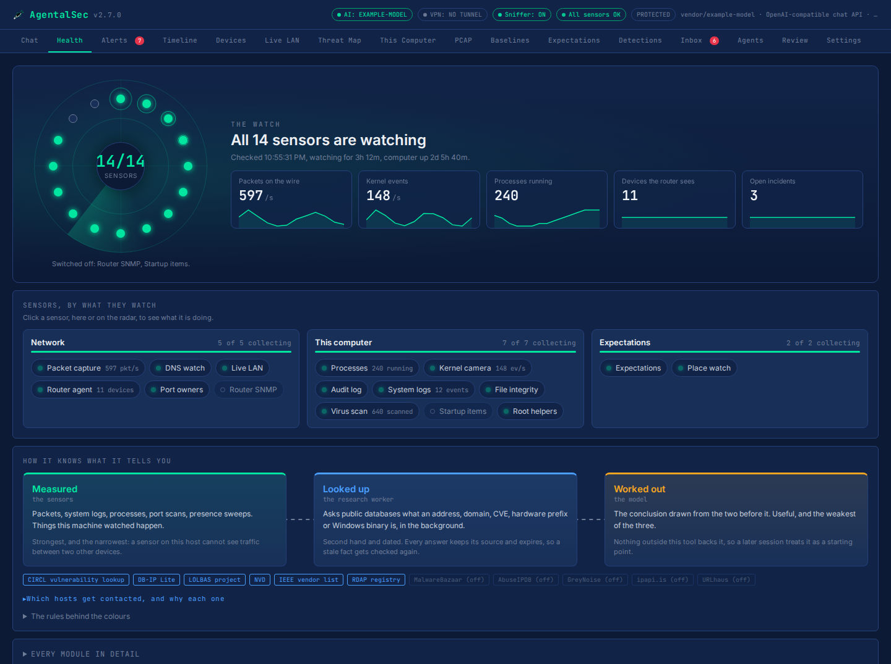
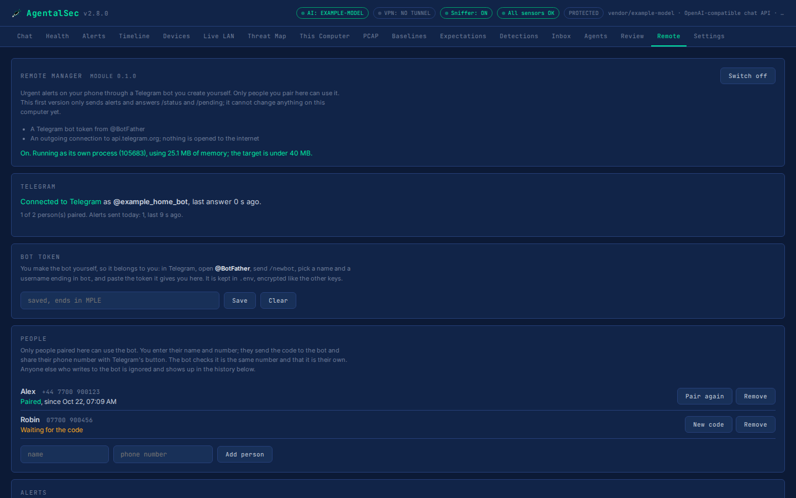

<p align="center">
  <picture>
    <source media="(prefers-color-scheme: dark)" srcset="assets/logo/orca_hero_dark.svg">
    
  </picture>
</p>

# AgentalSec Linux

## Why I built it

I wanted to know what was happening on my own network: which devices were on
it, what each one talked to, and when something changed, explained in plain
words by something I could ask. I could not find that in one place. LuCI, the
web page of an OpenWrt router, sets the router up and shows what is connected,
but it does not judge anything or remember what normal looks like. Wazuh is a
serious security platform, but it is built for companies: an agent on every
computer, a central server to run, and its eyes mostly on logs rather than on
the traffic between the devices. What I wanted sat between the two: one app,
on one computer, that watches the whole home network through the router,
learns what is normal for each device, tells me plainly when something is
not, says so when it cannot see, and never acts without my approval. That is
AgentalSec.

You do not have to sit and watch it. If the terminal output looks like
gibberish to you, that is fine: set the rules the way you want them, close the
browser and leave the app running in its terminal. Minimise the terminal, do
not close it, because closing it stops the app. AgentalSec keeps watching on
its own, and with no browser open it uses less RAM. If you run an agent such as
OpenClaw or Hermes, let it do the reading for you: it can ask AgentalSec's
local API for the same data the dashboard shows, with your
`AGENTAL_APP_API_KEY`, and tell you exactly what is happening. Want the
dashboard back? Open http://127.0.0.1:5000 again. Done for the day? Press
Ctrl+C in the terminal, or the Stop AgentalSec button on the Settings tab,
which stops it just as cleanly, and start it again whenever you like.

## What it is

Network and host security monitoring for Linux, with an AI analyst that
investigates but never acts without your approval.

AgentalSec watches your network and the machine it runs on, keeps what it sees
in a local database, and lets you ask a language model about it in plain
language. It runs entirely on your own machine. It is built around one rule:
a sensor that cannot see must say so, because a quiet dashboard and a blind
one should never look the same.

<p align="center">
  
</p>

*The Health tab, which replaces the Dashboard tab: every sensor, live, and
what it is doing. Sample data.*

## Best setup

AgentalSec works on its own on any Linux computer. It sees everything that
computer does. It sees your **whole network** when it is paired with a router
it can talk to:

1. **AgentalSec on a Linux computer** that stays on: a desktop, a laptop, a
   mini PC or a Raspberry Pi.
2. **A router that allows SSH access**, with the small AgentalSec agent
   installed on it. That includes:
   - routers running **OpenWrt**, and similar open firmware;
   - a **Raspberry Pi or any Linux box** set up as your router;
   - **pf based firewalls**;
   - any router with an SSH server, a root shell and a standard `sh`.

With the agent on the router, AgentalSec sees every device on your network,
its live traffic and where it connects, including phones, TVs and other
devices that never talk to the AgentalSec computer. It can also block a
device, an app or a domain on the router itself, with your approval.

**Modem or router?** The box from your internet provider is usually a modem
and router in one, and most of those do not allow SSH. The usual setup is to
put your own router behind it: connect an OpenWrt router (or a Linux box
acting as one) to the provider's box, and connect your devices to that
router. The provider's box then only brings the internet in, and your router,
which AgentalSec can talk to, runs your network.

How to enrol a router: [docs/ROUTER.md](docs/ROUTER.md).

## Documentation

- [docs/TOUR.md](docs/TOUR.md), every dashboard tab, with screenshots
- [docs/SENSORS.md](docs/SENSORS.md), every sensor: what it watches, what it
  needs, how it fails, how to configure it
- [docs/ANALYST.md](docs/ANALYST.md), connecting a model, what the analyst
  can do, approval, the duty loop
- [docs/ROUTER.md](docs/ROUTER.md), the router agent, Pi-hole and AdGuard
  Home, other Linux machines over SSH
- [docs/PRIVACY.md](docs/PRIVACY.md), privacy and security: every measure
  that protects your data on this machine
- [SETUP.md](SETUP.md), installation step by step, and
  [updating an install](SETUP.md#updating)

## How it works

1. **Sensors.** About thirty modules, each watching one thing: packets,
   processes, logs, ports, devices, files. Every observation goes into a local
   SQLite database together with the name of the sensor that made it.
2. **Memory.** Packets, events, devices, findings, incidents, and a slowly
   built picture of what normal looks like on your network. Old data is
   rolled up into hourly summaries and pruned on a schedule.
3. **Analyst.** A language model with about a hundred tools for reading that
   memory. It can read almost anything. Every action that changes your system
   waits for your approval.

Every answer comes from one of three places, and the dashboard colours them
differently: **measured** by a sensor here, **looked up** in a public source,
or **worked out** by the model. When a sensor cannot see, for lack of
privilege, a missing tool or a service that is off, it says so on the
dashboard and to the analyst.

## What it watches

**On the network.** Every packet on this machine's link, with the process
behind each connection. Beacons, the timing signature of malware checking in.
Attack signatures in plaintext traffic. Server names and JA3 fingerprints of
encrypted connections, QUIC included. DNS lookups, checked for machine
generated domains and DNS beaconing. ARP spoofing, rogue DHCP servers and name
poisoning on the LAN. The devices on your network and how each was
identified. TCP and UDP port scans.

**On this machine.** Every process, checked against the digest its package
recorded at install. Every listening socket and its owner. The journal, auth
log and audit log. An optional eBPF camera that records every process start
and outbound connection as it happens. File integrity for system files and
SSH keys, and an hourly sweep for setuid programs. Startup entries, installed
software, background apps you can switch off, VPN state.

**Beyond this machine.** Your router, through a small agent over SSH, on
OpenWrt, a Raspberry Pi or Linux box acting as a router, or any router with
SSH access: every device's live traffic, its destinations, and blocks on the
router (see [Best setup](#best-setup)). Pi-hole or
AdGuard Home query logs. Other Linux machines over SSH. See
[docs/ROUTER.md](docs/ROUTER.md).

**Threat intelligence.** ThreatFox, URLhaus, Feodo Tracker, AlienVault OTX and
the CIRCL MISP feed, matched against what your network talks to. The CISA
catalogue of known exploited vulnerabilities, with severities. Lookups of
addresses, domains, CVEs and file hashes in public sources.

**What normal looks like.** Every address, process, port and user is watched
across sessions, and behaviour far outside its own normal becomes a
deviation. Each program and each device also learns the countries and
networks it normally reaches, and after a three day learning period a first
contact with a new one becomes an alert.

Every sensor, in detail: [docs/SENSORS.md](docs/SENSORS.md).

<p align="center">
  
</p>

## The AI analyst

<p align="center">
  
</p>

Ask in plain language: "check my connections", "any intrusions?", "what is
this process?". The analyst answers from the database through about a
hundred narrow tools, and can read the app's own source code to explain how a
finding was produced. It has no shell.

- **Any model.** OpenAI-style and Anthropic-style APIs, hosted or local
  (Ollama, LM Studio, vLLM, SGLang).
- **It says what it could not see**, and tells "nothing happened" apart from
  "nothing was looking".
- **It asks you** when it needs something only you know, and remembers past
  cases.
- **It keeps expectations.** Every block holds, the same devices stay, DNS
  goes through the router, nights stay quiet. The app checks them itself
  against the router, with no AI tokens, and shows a network mood and the
  false alarms per day.
- **It works while you are away.** An incident watcher groups findings as
  they arrive, and a duty loop wakes during the day, or at once in an
  emergency, to investigate and write a report. Each evening it writes a
  daily security report you can print or save as PDF.

**Nothing changes without your approval.** Ending a process, a firewall
block, quarantining a file, disabling a service, a block on the router: each
is proposed as a card and waits for you. An approved action is carried out
once, by a separate worker, and recorded.

Connecting a model, the full list of gated actions and the duty loop:
[docs/ANALYST.md](docs/ANALYST.md).

## How it helps stop an attack

AgentalSec finds the problem, works out what is happening, proposes the
response and carries it out the moment you approve. It never acts on its own.
A typical case, from start to finish:

1. **A sensor sees it.** A program on this machine starts calling the same
   unknown server every minute, or a device on your network looks up a domain
   that a threat feed lists.
2. **The incident watcher groups it.** Related findings become one incident,
   so ten alerts about one cause are one case. A high severity incident sends
   a desktop notice, and a burst inside ten minutes arrives as one notice.
3. **The analyst investigates.** For a high severity incident the duty loop
   wakes at once. It reads the evidence through its tools: the program and its
   file, where it connects, the threat feeds, what that device normally does.
   Then it writes a report with its verdict on the Agents tab.
4. **It proposes the response.** The request appears in the Inbox,
   saying what it would do and why. Nothing has run yet.
5. **You decide.** Approve, and a separate worker carries it out once and
   records it, even if the dashboard is closed. Deny, and nothing happens.

The responses it can propose, from the narrowest to the widest:

- **On this machine:** end a process, stop a service, quarantine a file
  (moved to a vault, and restorable), switch off a background app.
- **At this machine's firewall:** block a port, or a device's traffic to and
  from this computer.
- **On the router,** with the router agent: cut a device off the whole
  network, or sinkhole a domain so that no device can reach it. From the LAN
  tab you can also block a single app, such as TikTok or Fortnite, for one
  device.

A block on this computer's firewall protects this computer only. A block on
the router protects every device on your network, which is why a router with
the agent is the recommended setup ([Best setup](#best-setup)). Blocks,
quarantines and background app changes can be undone from the Inbox.

Alerts that turn out to be harmless can be silenced for one rule on one
device or file, without hiding anything else about it, so the next real
alert stands out.

## Living with it

**Give it time.** AgentalSec is meant to run for a while before you judge it.
In the first days it learns what normal looks like on your network: every
device, where each one connects, which programs run. Watch what it raises,
answer its questions and give each incident a verdict. That review is what
teaches it. Once the database knows your network, it carries on much more
smoothly: fewer alarms, and the ones left are worth reading.

**The rules keep the alarms clean.** The quiet rules the analyst learns, and
the rules you mute or tune, decide only what AgentalSec raises and shows you.
Most of them never touch the router's firewall, your devices or any other part
of the network. Every rule is listed with what it held back and an Undo.

**Cutting a device off is a convenience.** From the dashboard you can take a
device, or one app on it, off the internet at the router, and let it back on.
That is there because it is handy, not because the app needs it: AgentalSec
watches either way, and it blocks nothing unless you say so.

**It looks after itself.** As I kept improving the code, I wanted every change
to reach my own install without steps I could forget. That is why there is an
installer that does the whole setup, launchers, an update script that brings
in a new version and reinstalls whatever it changed, and services that start
again on their own when their code changes. The same path updates your copy.
The app tells you when a new version is out, and one button on the Settings
tab installs it, helpers and sensors included, and restarts it.

**Light on memory.** My own computer has always been short of memory. So the
This Computer tab lists the ordinary background programs that nothing depends
on, and lets you stop them to free memory, with an Undo for each.

The app keeps its own share small too. Most of what the main process holds is
the libraries it needs, measured on my laptop:

- Python itself, 11 MB
- Flask, which serves the dashboard, 19 MB
- requests and httpx, for the feeds and the model, 14 MB
- paramiko, for reading the router, 16 MB
- scapy, 49 MB, loaded only by the capture service and when you analyse a
  capture file
- the app's own code, 4 MB
- the dashboard open in a browser tab, about 50 MB more

The rest is the data it works with. The dashboard is the one part you can
drop any time: close the browser and leave the app running in its terminal,
it keeps watching without it. To start it that way, set
`flask.auto_open_browser` to `false` in `config.json`.

The main process used to grow after start and never come back down. After the
memory fixes, on the same laptop:

- 5 minutes after start: 238 MB before, 177 MB now
- 10 minutes after start: 399 MB before, 188 MB now

## Remote manager, alerts and decisions on your phone

<p align="center">
  
</p>

*The Remote tab with one person paired and one waiting for a code. Sample
data.*

When something serious happens while I am away from the computer, I want to
know. Remote manager sends the urgent alerts to your phone through a Telegram
bot that you make yourself with @BotFather, so the bot belongs to you.

- **Only people you pair can use it.** You enter a name and a phone number,
  the person sends the bot a one-time code and shares their number with
  Telegram's own button. The bot checks it is the same number and their own.
  Anyone else who writes to it gets no answer and is listed in the tab's
  history.
- **The same alerts as the desktop.** New high and critical incidents, and
  ones raised to that level. A burst becomes one message, there is a daily
  limit, and you can set quiet hours that only critical gets through.
- **It answers a few questions.** `/status` says how the computer is doing,
  `/pending` lists what waits for your decision. Both are in the bot's menu
  and on two buttons under every alert.
- **Decisions from the phone, behind a PIN and an authenticator code.** A
  paired person who also set up control at the computer (their own PIN, an
  authenticator app such as Aegis or Google Authenticator, and a panic word)
  presses **Take control**, sends the PIN and the code, and for 30 minutes
  can approve or deny actions, answer the agent's questions, give verdicts on
  incidents and let held devices in. A taken over Telegram account is not
  enough, and Telegram never sees the authenticator key, so it cannot fake an
  approval either. Each code works once, three wrong tries lock that person
  until you unlock them at the computer, and the panic word turns control off
  for everyone.
- **Nothing is opened to the internet.** The bot only connects out to
  Telegram. Telegram can read bot chats, so nothing secret is ever sent;
  an alert carries the incident's title and the device it is about.

**It is a module, and off means off.** Remote manager is the first add-on
built on a rule I set for everything new: it is not on unless you switch it
on, and switched off it is gone, with no process, nothing loaded and no
memory used. Switched on it runs as its own small process, about 30 MB. It
reads what the app shows it, and decides only through the same calls the
console uses. Everything about it lives in its own tab: the switch, the bot
token, the people and their control, the alert choices, the history with
every phone decision and who made it, and a button that removes everyone at
once. See the
[Remote tab](docs/TOUR.md#remote) in the tour.

## How well it detects malware

Because of my own limits, I could not test AgentalSec against its full
detection capabilities. I built and tested it in a home lab: one home
network, a handful of computers, phones and consoles, and no real malware.
That is enough to show that each detection works as designed. It is not
enough to say how much real malware it would catch.

Measuring that takes a malware lab: a large collection of real, current
samples, run one after another on isolated machines that can be wiped, with
a record of which ones were caught. Running real malware on my home network
would put every device on it at risk, so I never did.

What the tests here do cover:

- **Every sensor is tested by acting out the attack.** Packet capture and the
  beacon detector, the eBPF camera, auditd, the DNS and threat feed checks,
  the LAN and router watch, file integrity and autoruns each have their own
  tests. Harmless stand-ins play the attacker: a program started from a
  temporary folder, a fake program wearing a system name, a regular check-in
  to a test server, a lookup of a domain from a threat feed, a new autostart
  entry.
- **The network tests use real traffic.** Real packets, raw sockets and
  firewall rules run inside an isolated network namespace, so the detections
  and blocks are exercised for real while nothing reaches the home network.
- **Blocks are tested as well as alarms,** on this machine and on the router.
- **Each detection stays quiet on normal use.** The same rules run against
  everyday activity on a real home network, and the noisy ones were tuned
  until they stopped raising alarms about ordinary devices and services.
- **File scanning, when ClamAV is installed.** Running programs and new
  files in temporary and download folders are scanned against ClamAV's
  signatures, tested with the standard EICAR test file. This finds known
  malware families only; how much it catches depends on ClamAV's database.
- **AgentalSec's own code is checked too.** Bandit, Semgrep, pip-audit,
  gitleaks, Trivy and ShellCheck are part of the test suite, and the web API
  is scanned with OWASP ZAP on a throwaway copy.

What they cannot tell you:

- **How often it catches malware nobody has seen before.** That depends on
  how the malware behaves, and only a large, varied set of real samples can
  answer it. ClamAV covers known malware; new malware is left to the
  behaviour-based detections.
- **A detection rate.** No percentage is claimed, because no honest one could
  be measured in a home lab.

With ClamAV installed, AgentalSec also scans files, but it is not a full
antivirus: it scans on a schedule rather than at the moment a file is opened,
and it does not scan memory. So treat it as a second pair of eyes, and its
findings as leads to follow up. If you can test it in a proper malware lab,
your results would be very welcome.

## Where better detection will come from

This is planned, not built yet. Each part will be an optional module, like
Remote manager: off unless you switch it on, and AgentalSec keeps working the
same without them.

- **A sandbox.** A throwaway Linux virtual machine, reset to a clean copy
  before every job, with its network off by default. The agent can unpack
  and read an unknown file there and, with your OK, run it and watch what it
  does, without risking your computer. It needs a computer with
  virtualization switched on.
- **Hold before it runs.** When a new, unknown program tries to start from
  Downloads, a temporary folder or a USB stick, fast fixed rules pause it,
  and the agent checks it. Only if the agent finds a real problem does the
  pause become a quarantine; if it finds nothing, the pause is lifted.
  Nothing is deleted or blocked for good without your approval, and a
  quarantined file can always be restored.
- **More ways to recognise a file.** YARA rules next to ClamAV, and a
  known-good lookup so ordinary software stops raising questions.
- **Ransomware tripwires.** Decoy files that nothing legitimate ever touches,
  and a watch for many files being rewritten at once. Both work without the
  internet.

The sandbox also changes the testing story. It is the first safe place on a
home computer to run real samples, a few at a time, with a record of which
ones were caught. That is still not a malware lab, but it is a step toward
one.

## Keeping itself honest

- Important writes go into a **hash-chained tamper journal**, so a later edit
  to the database shows up.
- The analyst may **silence** at most 10 things a day, and the Review tab
  shows everything silenced and who did it.
- The Settings tab lists **every collector** and why it is on, off or broken.

<p align="center">
  
</p>

The dashboard has 16 tabs, from live LAN traffic to the network's
expectations. A tour of each: [docs/TOUR.md](docs/TOUR.md).

## Requirements

- Linux with apt. The automatic install is tested on Ubuntu 24.04, Ubuntu
  22.04 (the base of Linux Mint 21) and Debian 12; the app runs on Linux Mint.
- Any CPU that runs Python, including x86-64 and ARM64.
- Python 3.10 or newer.
- For packet capture, the capture service, which the installer sets up (see
  [Running without root](#running-without-root)).
- For the analyst: an account with a model provider, or a local
  OpenAI-compatible server. Everything else runs without one.
- Python packages from `requirements.txt` (maxminddb reads the map data).
- Free data files, fetched once by the scripts below: DB-IP IP to City Lite
  for the threat map, DB-IP IP to ASN Lite for network owner names and
  network baselines (both CC BY 4.0, attribution shown on the map), and the
  IEEE registry for hardware vendor names.

## Quick start

**The install is now automatic.** On Ubuntu, Debian or Linux Mint, three
commands do the whole thing:

```bash
git clone <repository-url> agental_sec_linux
cd agental_sec_linux
./scripts/install.sh
```

`<repository-url>` is the address under the green **Code** button at the
top of this page. No `git` yet? `sudo apt install git` first.

Run it as your own user, not with sudo. It first asks a few questions: your
model provider's chat address, the model and its key (each can be left empty
and set later on the Settings tab), and whether to add the optional malware
scanner. Then it runs on its own, asking for your password once, for the
system packages, and does every install step in [SETUP.md](SETUP.md): system
and Python packages, the config files, a new dashboard key, the map and
vendor data, a check of the result, the capture service and the root
helpers, and the **AgentalSec** launchers in your app menu, on your desktop and in the project
folder. Running it again is safe: it keeps your settings and downloads
nothing it already has.

When it finishes, start AgentalSec from its icon. The dashboard opens at
http://127.0.0.1:5000, already signed in. Opened by hand, it asks once for the
dashboard key the installer printed (it is also in `.env` as
`AGENTAL_APP_API_KEY`), and that browser stays signed in for 30 days. If a
desktop icon says "untrusted", right-click it and choose "Allow launching".

The optional parts (the kernel camera, your router, start on boot) and every
step done by hand are in [SETUP.md](SETUP.md). To update later: the
Update button on the Settings tab, or `./scripts/update.sh`.

## Running without root

Since 18 October 2026 AgentalSec runs without root, and that is how it runs
on my own network. Before, packet capture meant starting the whole app as
root. Now the app is split by the rights each part needs:

- **The app itself** (the dashboard, the analyst, the database, incidents and
  reports) runs as you, with no special rights.
- **The capture service** reads the packets and runs the LAN checks. It runs
  as you too, with only the two network rights packet capture needs.
- **The names helper** runs as root and does one thing: every second it reads
  the kernel's list of connections and writes down which program owns each
  one. It accepts nothing, has no network, and never sees a packet. With it,
  every packet still names the program behind it, root's programs included.
- **The kernel camera, the read helper and the action helper** were already
  separate: the camera records every program start and connection, the read
  helper reads the few things only root can read (such as failed logins and
  the firewall's rules), and the action helper carries out the actions you
  approve.

**Why.** The code that reads packets reads bytes that anyone on the network
can send. Running it as root meant one bug there could hand the whole computer
to whoever sent the packet. Now that code holds only the right to capture, the
dashboard and the analyst hold nothing, and root is left to small helpers
whose only inputs are the kernel's own tables.

**What you get.**

- A bug in the packet code can no longer give anyone root.
- The same view as before: every packet, every program named, every check.
- If the capture service stops, the dashboard and the analyst keep running,
  say capture is not reporting, and systemd starts it again.
- No password to start the app, and it starts faster.
- About the same memory as before, spread over smaller processes.

The installer sets all of this up, and `./scripts/update.sh` reinstalls a
helper whenever an update changes it, asking for your password once. On an
older install, `./scripts/update.sh` offers to install the capture service, or
run once:

```bash
sudo ./scripts/install_capture_service.sh --apply
```

Then start AgentalSec from its icon. Both icons start it as you once the
service is installed. `./scripts/install_capture_service.sh --verify` checks
the services, and the dashboard says when a root helper's installed copy is
older than the project, with the command that brings it level.

## Privacy

AgentalSec is hosted only on your own computer, and it still guards your data
as if every other program, every other account and every web page were a
stranger. The full list is in [docs/PRIVACY.md](docs/PRIVACY.md). In short:

- **Your data stays on this machine, readable by you only.** The database,
  `config.json`, `.env`, the logs and each module's data are owner only, and
  the app narrows them again at every start. `/var/lib/agental_sec`, where the
  kernel camera and names helper write, is closed to every other account.
  There is no telemetry.
- **Secrets are encrypted.** Keys live in `.env`, never in `config.json`,
  encrypted with a key derived from this machine and your account, so a copy
  does not open anywhere else.
- **Loopback only.** The dashboard listens on 127.0.0.1, so nothing on your
  network can reach it. A request that names any other host is refused, which
  stops web pages reaching it through your browser. From another computer,
  use an SSH tunnel (see [SETUP.md](SETUP.md)).
- **Signed in, not guessable.** Every API call needs the app key, compared in
  constant time, and repeated wrong keys lock the caller out. The page holds
  no key: the browser signs in once through a two minute, one time link and
  keeps a signed 30 day session. The page runs no script but its own.
- **Hashes that make tampering visible.** High value writes go into a hash
  chained journal, the files that decide who gets in are hashed and watched,
  and sessions, links and pairing codes are signed or stored only as hashes.
- **Every part has only the rights it needs.** The app runs as you. Packet
  capture, the names helper and the kernel camera are separate services with
  a few capabilities each, sandboxed by systemd, and two of them have no
  network at all. Anything done as root goes through two narrow helpers, and
  a change to your system only after you approve it.
- **Hostile text stays text.** Names and payloads an attacker can choose are
  cleaned before they reach the logs, and fenced as evidence before they reach
  the model.
- **What leaves the machine:** your questions and the data the analyst's tools
  read, to the model you configure (none of it leaves your network with a
  local model); the threat feeds and lookups; a public address lookup for the
  map's home pin, off with `geoip.locate_online`; the daily update check; and
  Telegram, only with Remote manager switched on.

**[Read the full privacy explanation](docs/PRIVACY.md)**

## What it sees, and how to see more

Every security tool has edges. AgentalSec names its own, so you always know
what a quiet dashboard means, and for each one there is something that
extends its view.

- **It sees this computer, and your whole network with a router.** On its
  own, AgentalSec sees the traffic of the computer it runs on. Add the router
  agent ([Best setup](#best-setup)) and every device's internet traffic comes
  into view. Traffic between two devices inside your network stays private to
  them.
- **It reads what encryption leaves visible.** Most traffic today is
  encrypted, and AgentalSec does not pretend to read it. It reads what can be
  read: the server name and fingerprint of every encrypted connection, and
  full signatures on plaintext traffic.
- **It watches connections as well as open ports.** A port scan shows what
  is listening; outbound connections, such as a program calling home, are
  covered by packet capture, beacon detection and the eBPF camera.
- **Its beacon detector is tuned to avoid false alarms.** Very slow or
  deliberately irregular callbacks can fall outside it, so every repeated
  contact is also listed with its timing for you to judge.
- **It points you to a network, not a street.** The map places an address
  where its network is registered, which is good for "this left the
  country", not for finding a person.
- **It works alongside an antivirus, not instead of one.** With ClamAV
  installed it scans running programs and new files in /tmp, /dev/shm and
  Downloads against ClamAV's signatures, and checks each hit with
  MalwareBazaar. It does not scan memory, and it finds only what those
  signatures know. Without ClamAV, a suspicious program's hash is looked up
  in MalwareBazaar alone, which matches only files already uploaded there.
- **It is a watchman, not a vault.** It runs on the computer it protects, so
  anyone with full control of that computer could stop it. Its hash-chained
  journal makes later edits to its records visible, and its findings are
  strong leads for you to follow up.
- **It uses ordinary kernel interfaces,** the eBPF camera included. A rootkit
  built to hide below those can stay out of view, which is why the app shows
  exactly which sensors were watching at any moment.
- **It answers best to neutral questions.** Like any analyst it can be led by
  a confident claim. Ask neutrally, or name your devices on the Devices
  tab, and it works from facts.

## Tests

```bash
python3 scripts/run_tests.py
```

Each file in `tests/` also runs on its own with `python3 tests/<name>.py`.
The security tests need extra tools that the app itself does not use. Without
them those tests are skipped; to install them, see "Security test tools" in
[SETUP.md](SETUP.md#security-test-tools-developers-only).

## License

MIT, see [LICENSE](LICENSE).
