# A tour of the dashboard

Start AgentalSec from its launcher in your app menu or on your desktop. If
you have no launcher yet, run `./scripts/install_launchers.sh` once from the
project folder (step 9 of [SETUP.md](../SETUP.md)). The dashboard opens at
http://127.0.0.1:5000. It has 16 tabs. This page goes
through each one: what it shows, how to read it, and what you would do there.

Every picture on this page was taken from the real dashboard running on
made-up sample data: a home network at 10.99.0.x with a router, a desktop, a
work laptop, a phone, a TV, a kitchen camera, a printer, a speaker, a NAS and
a game console. In the story the pictures tell, the kitchen camera has been
talking to an address on a threat list. None of it is a real network.

Two habits run through every tab:

- **Quiet and unwatched look different.** An empty table always says why it
  is empty, so you can tell "nothing happened" from "that sensor is off" at a
  glance.
- **Three kinds of knowledge.** Green is measured by a sensor here, blue is
  looked up in a public source, amber is worked out by the model. A finding
  built on a measurement and one built on a guess never look the same.

The bar along the top is on every tab. The pills say whether the model
answers, whether a VPN tunnel is up, whether the packet capture runs, and
whether every sensor is still collecting; click Sensors for the detail. A red
number on a tab counts something waiting for you, and it goes away when you
deal with it.

[Back to the README](../README.md)

## Chat

  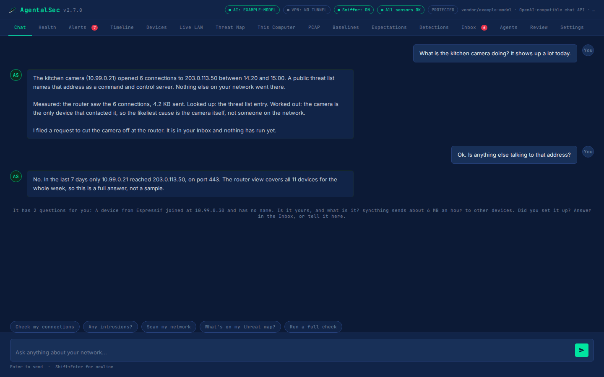

*Asking about the kitchen camera. The answer says what was measured, what
was looked up and what was worked out. Sample data.*

Talk to the analyst. The buttons above the input are starting points: check
my connections, any intrusions, scan my network, what is on my threat map, run
a full check. Enter sends, Shift+Enter starts a new line.

The analyst answers from what the app recorded, and says where each part came
from. Ask it about a device, an address, a program or a time ("what happened
at 3 this morning?") and it reads the same tables the tabs show.

When the analyst wants to do something that changes your system, an approval
card appears in the conversation and in the Inbox. Nothing happens until you
press approve. When it has a question for you while you are in the chat, it
asks there, once. See [ANALYST.md](ANALYST.md).

## Dashboard

  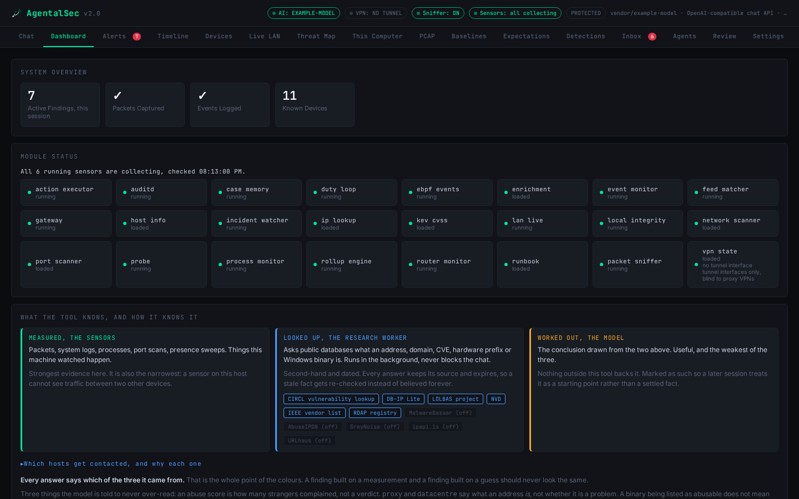

*Every module running or loaded, and the six running sensors all collecting.
Sample data.*

- **System overview.** Findings this session, packets captured, events
  logged, known devices.
- **Module status.** Every sensor and worker. A green dot is running or
  loaded, red is supposed to work and does not, with the reason underneath.
  A module that cannot see reads "blind" with the reason, instead of showing
  zero events. The line above the tiles says when the sensors were last
  checked. A tile with a setting links to its entry on the Settings tab, and
  says when a value saved there waits for a restart.
- **What the tool knows, and how it knows it.** The key to the three colours,
  and which public sources are switched on (blue boxes) or off (grey).
- **Which hosts get contacted, and why each one.** Every address the app
  talks to, grouped by purpose: lookups, the malware and vulnerability lists,
  the model provider, web search, the threat map, your router and network,
  and downloads you start yourself. Each row says what is sent, what comes
  back and why. A row that needs a key links straight to its field in
  Settings.

## Alerts

  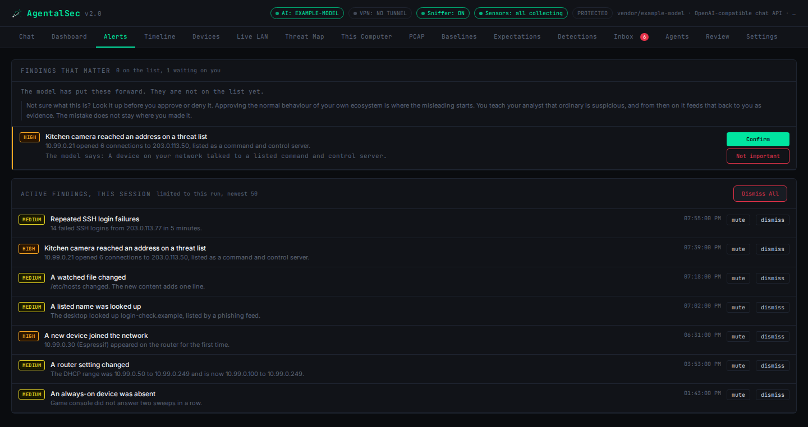

*The camera alert put forward by the model at the top, and every active
finding below it. Sample data.*

- **Findings that matter.** Findings the model has put forward as worth your
  time, with its reason in one line. Confirm puts one on the list, Not
  important sends it back. The model can suggest, only you decide.
- **Active findings, this session.** Newest first. Each has a severity, a one
  line title and the measurement behind it, written so you can check it.
  Mute stops that rule for that address (see Detections), dismiss hides the
  finding from this list, and Dismiss All does that for every finding shown.

## Timeline

  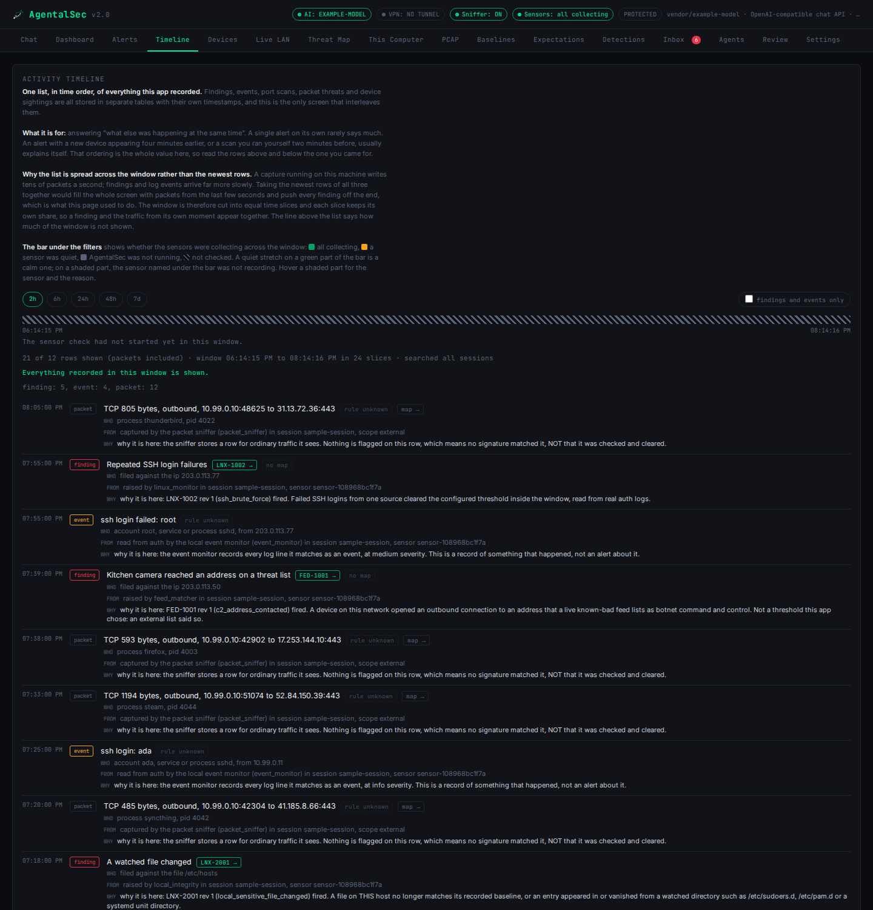

*The last two hours: packets, the SSH login failures, the event they came
from and the camera alert, in the order they happened. Sample data.*

Everything the app recorded, in time order: findings, events, port scans,
device sightings and packets. Its purpose is the question "what else was
happening at the same time". Choose a window of 2 hours up to 7 days. Packets
far outnumber everything else, so the window is cut into equal slices and
each slice keeps its share of rows. The line above the list says how much was
not shown. Tick "findings and events only" to hide packets.

Each row says who recorded it, which sensor and session, and why it is there.
A rule name opens that rule on the Detections tab, and "map" opens the address
on the Threat Map. The striped bar under the buttons shows whether the sensors
were collecting across the window, so a quiet stretch can be told from a gap.

## Devices

What is on your network, what you said belongs there, and what each device
answers on.

  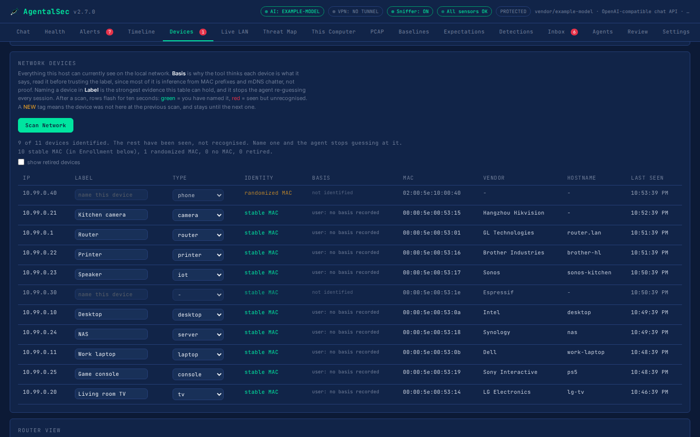

*Eleven devices: nine named, one new one waiting for a name, and a phone with
a private address. Sample data.*

- **Network devices.** Everything this machine can see on the local network:
  address, your label, type, identity, the **basis** for that identity,
  hardware address, vendor, hostname, last seen. Read the basis before
  trusting a label, most identities are inferred from vendor prefixes and
  announcements, not proven. Type a name in Label and pick a type, and the
  analyst stops guessing. Scan Network runs a presence sweep. After a scan,
  rows flash green if you have named them and red if unrecognised. NEW marks a
  device that was not there at the previous scan.
- **Router view.** With the router agent: what the router says is on the
  network. A device that ignores ping still shows here because the router
  exchanged its traffic. NOT SEEN HERE marks a device the router talks to that
  no sensor on this machine has ever seen, a gap in coverage.
- **Router settings.** The router's DNS, DHCP and gateway settings as last
  read. CHANGED marks a value that differs from the one recorded before.

  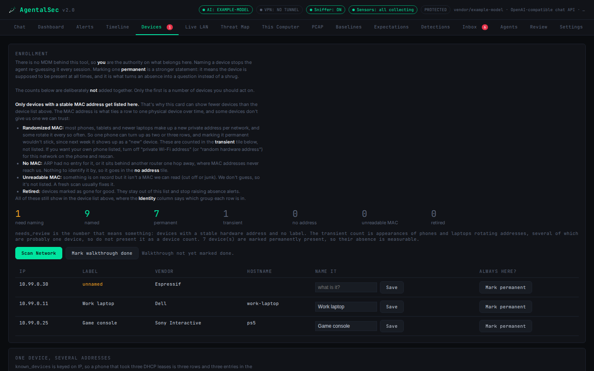

*Enrollment: one device needs a name, two named devices are not yet marked
permanent. Sample data.*

**Enrollment.** You are the authority on what belongs on your network, and
this is where you say so.

- **Name** a device and the analyst stops guessing what it is.
- **Mark it permanent** if it should always be present. Its absence then
  becomes a question instead of being ignored.
- **Merge** two rows that are one device with several addresses, under
  "One device, several addresses".
- **Probe** re-checks each permanent device every few weeks and reports what
  changed about it.

The tiles are never added together: need naming, named, permanent, transient,
no address, unreadable and retired each count something different. Only
devices with a stable hardware address are listed. Phones and newer laptops
that invent a new private address per network are counted in the "transient"
tile instead, since marking one permanent would not stick. To list your own
phone, turn off "private Wi-Fi address" for this network on the phone and scan
again.

  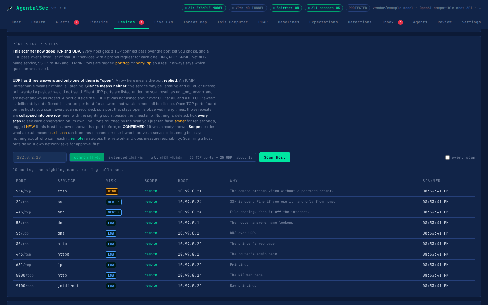

*Open ports on the NAS, the printer, the router and the camera, with a reason
on each. Sample data.*

**Port scan.** TCP and UDP scans of the hosts you choose. Enter a host, pick a
set (common, extended or all 65,535 ports, each with its cost on the label)
and press Scan Host. Scans of hosts outside your own network ask for approval
first. **Why** says in plain words what the port is and whether it is worth
worrying about; **Risk** is high only when the reason is real, like the
camera's video stream answering without a password.

- **UDP has three answers.** A row means the port replied. An ICMP
  unreachable means nothing listens. Silence means neither, and is never
  shown as closed.
- **Scope.** A self-scan proves a service is listening on this machine, not
  that anyone can reach it. A remote scan across the network does measure
  reachability.
- **Repeats** of the same open port are collapsed into one row with a count.
  Tick "every scan" to see each observation.

  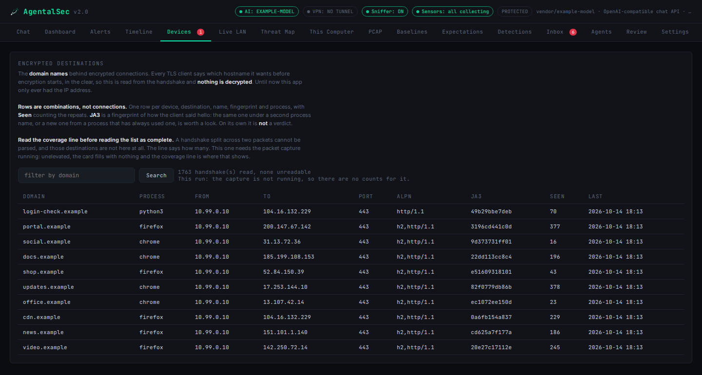

*The names behind the desktop's encrypted connections. The odd one out is a
listed name reached by python3, not by a browser. Sample data.*

**Encrypted destinations.** The domain names behind encrypted connections.
Every TLS client says which name it wants before encryption starts, so this is
read from the handshake and nothing is decrypted. One row per device,
destination, name, fingerprint and program, with **Seen** counting repeats.
**JA3** is a fingerprint of how the program said hello: the same one under a
new program name is worth a look, on its own it is not a verdict. The line
next to the filter says how many handshakes could not be read. It needs the
packet capture running.

## Live LAN

  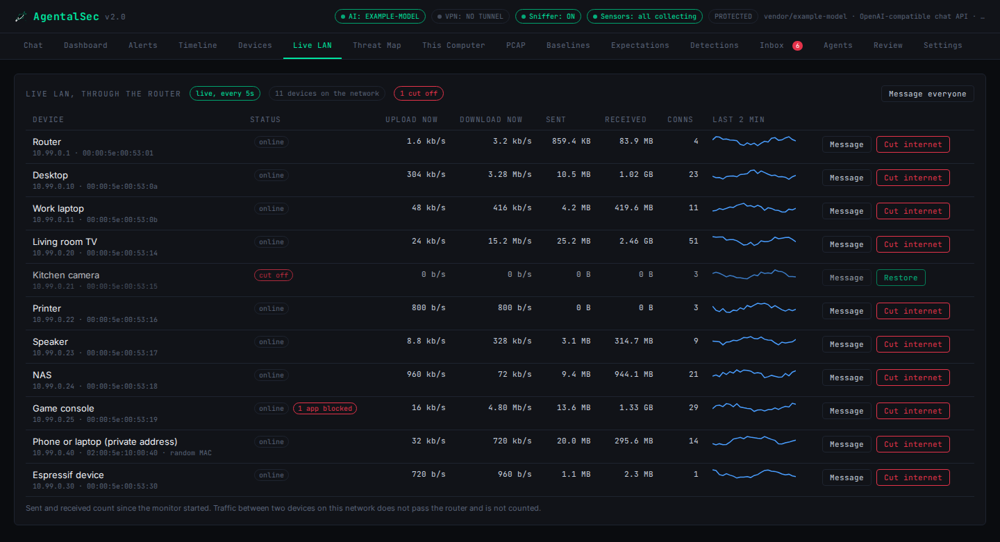

*Every device through the router, live. The kitchen camera is cut off, and
TikTok is blocked on the game console. Sample data.*

With the router agent enrolled: every device on the network with its upload
and download right now, totals since the monitor started, open connections and
a two minute graph. Every row has **Cut internet**, which takes that device
off the internet at the router, and **Restore** to bring it back. **Message**
shows a note on the router's own page to one device or to everyone, and their
replies come back here.

  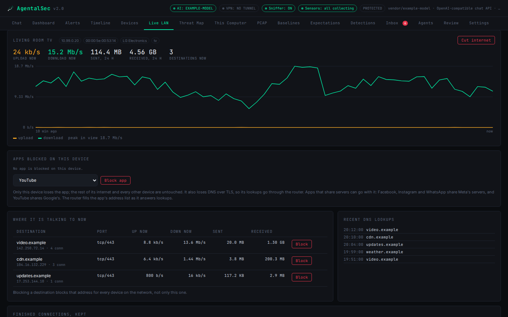

*The living room TV: ten minutes of traffic, where it is talking to now, and
its last name lookups. Sample data.*

Select a device to see its traffic over the last ten minutes, where it is
talking to now, its recent DNS lookups and its finished connections. From
here you can block an app for this one device (YouTube, TikTok and others; the
rest of its internet stays), or block a destination for the whole network.
Traffic between two devices at home does not pass the router and is not
counted. See [ROUTER.md](ROUTER.md).

## Threat Map

  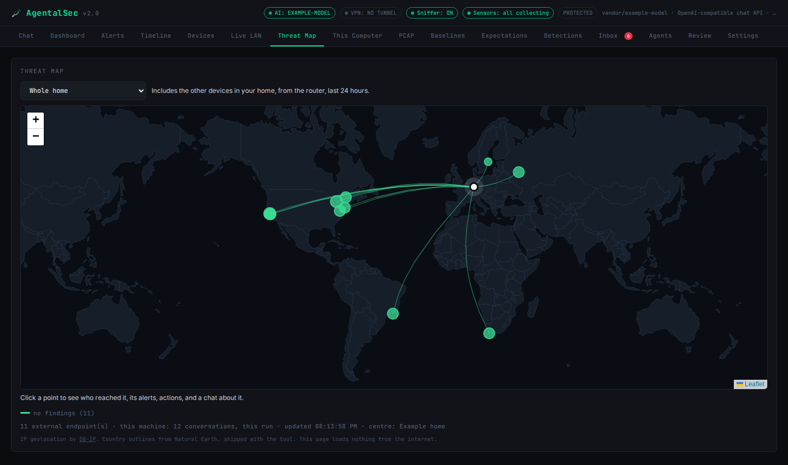

*The whole home for the last 24 hours, from the example home in Frankfurt.
Sample data.*

Where your home's connections go. Each circle is an external address, and
its colour comes from the alerts recorded about it, never from the country.
The white pin is home, placed from your public address or, when that is off
or contradicts your timezone, from the timezone. You can also set it by hand
in Settings. The map and its database are local, the page loads nothing from
the internet. Locations are approximate, see the limitations in the README.

**Whole home or this machine.** The map covers the last 24 hours, and a
restart does not empty it. This machine's own traffic is always on it, with
the program behind each connection. With the router agent, the other devices
in your home are added too, each line named by device. Without a router agent the map still shows every
destination this machine reached, and says the rest of the home is not
covered. The menu above the map shows the whole home, this machine only, the
other devices only, or only the places with an alert.

  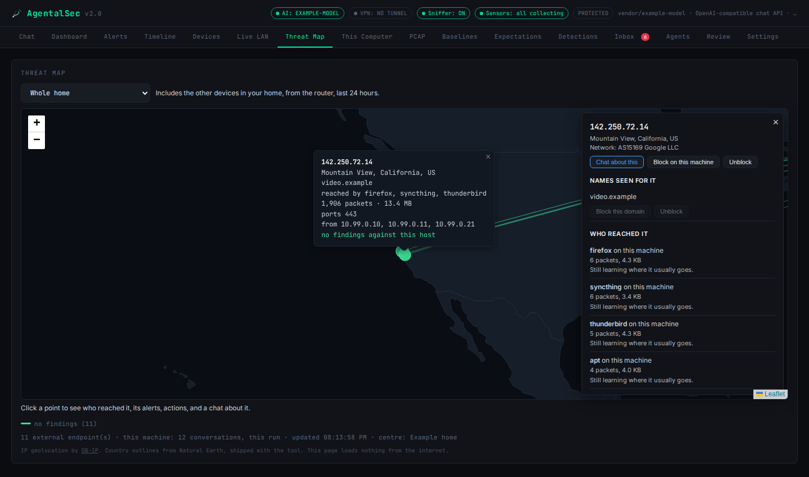

*One address opened: where it is, the network that owns it, the name seen for
it and each program that reached it. Sample data.*

**Click a point** to open its panel: where it is, the network company that
owns it (with the optional ASN database, `scripts/fetch_geoip.py --asn`), the
names seen for it, which programs and devices reached it, whether that is a
place each of them usually goes, and every alert about it. The panel offers:

- **Block** the address: at the router for every device when the router
  agent is there, otherwise on this machine only.
- **Cut off** a device that reached it, at the router.
- **Block a domain** seen for it, at the router's resolver.
- **Chat about this**, which opens a small chat window you can drag anywhere
  on the screen and resize from its corner. The analyst is given what the app
  recorded about that address, and each address keeps its own conversation,
  separate from the Chat tab. Approval cards work there as in the Chat tab.

Router actions are greyed out without the router agent, and hovering says
why. Every action asks for a reason and is recorded.

## This Computer

  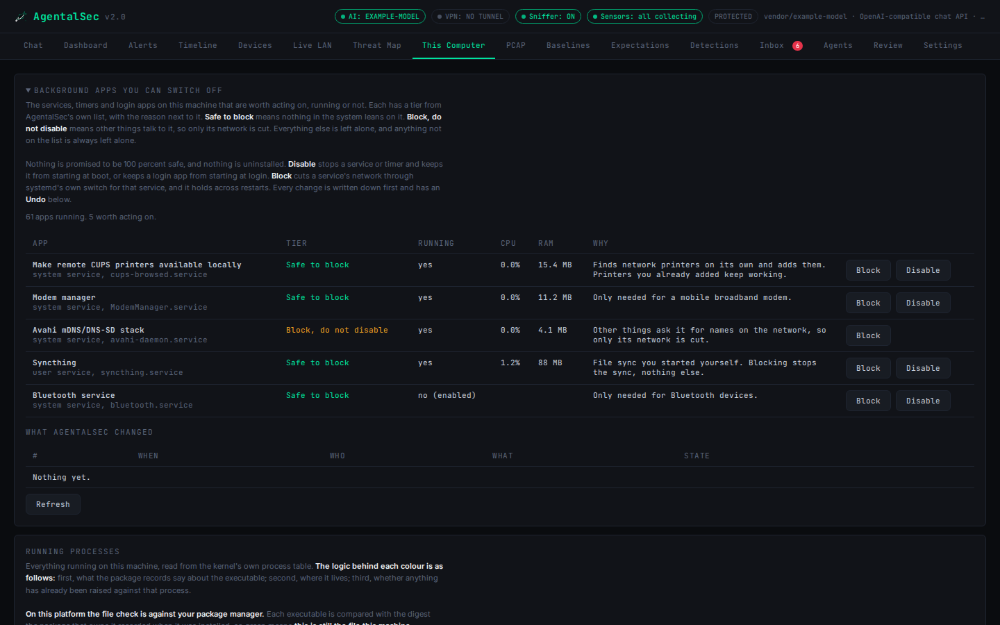

*Five background apps worth acting on, each with its tier and the reason.
Sample data.*

- **Background apps you can switch off.** Services, timers and login apps
  worth acting on, running or not, each with a tier and a reason. "Safe to
  block" means nothing leans on it. "Block, do not disable" means other things
  talk to it, so only its network is cut. Block cuts the app's network,
  Disable stops it and keeps it from starting again. Every change is recorded
  under "What AgentalSec changed", each with an Undo. Nothing is uninstalled.

  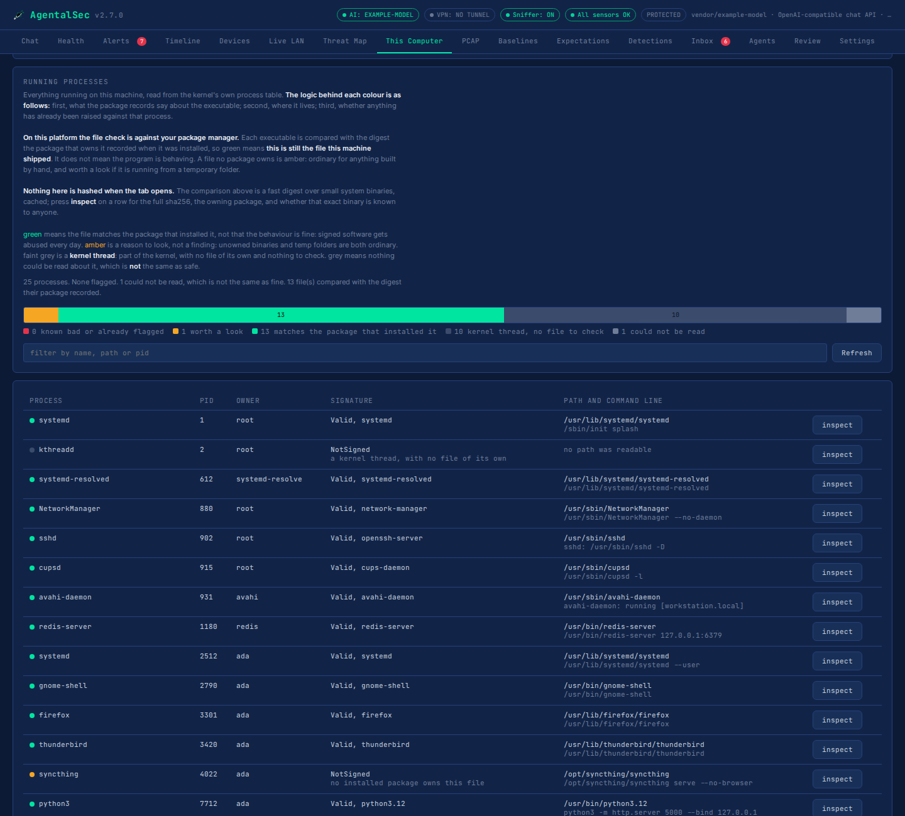

*The bar counts processes by colour. Sample data.*

- **Running processes.** Everything running, from the kernel's process table.
  Green means the executable still matches the digest its package recorded at
  install. Amber means no package owns it, ordinary for things you built
  yourself, worth a look in a temporary folder. Faint grey is a kernel thread,
  grey means nothing could be read about it, which is not the same as safe.
  Click a colour in the bar to hide or show that group, and type in the filter
  to find a name, a path or a process number. Press inspect on a row for the
  full hash, the owning package and whether that exact file is known to public
  malware databases.

  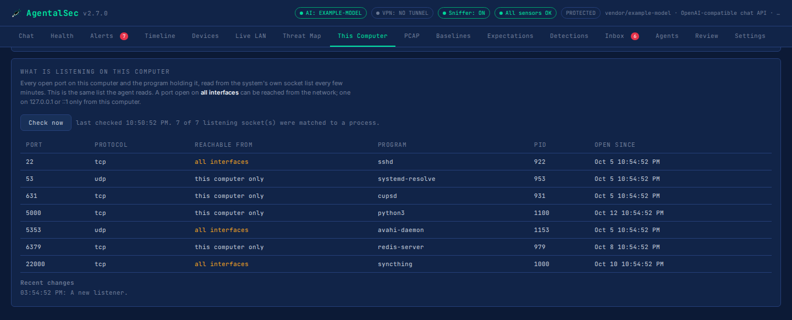

*Seven listening ports, three of them open to the network. Sample data.*

- **What is listening on this computer.** Every open port here and the
  program holding it, read from the system's own socket list every few
  minutes. A port open on all interfaces can be reached from the network, one
  on 127.0.0.1 only from this computer. Changes since the last check are
  listed under the table. Check now reads it again.

## PCAP

  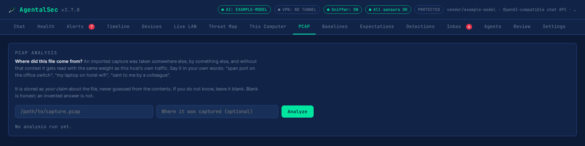

*Sample data.*

Import a capture file taken somewhere else and analyse it. You are asked where
it came from, in your own words ("span port on the office switch", "my laptop
on hotel wifi"), and that note is stored as your claim about the file so it is
not read with the same weight as this machine's own traffic. If you do not
know, leave it blank.

## Baselines

  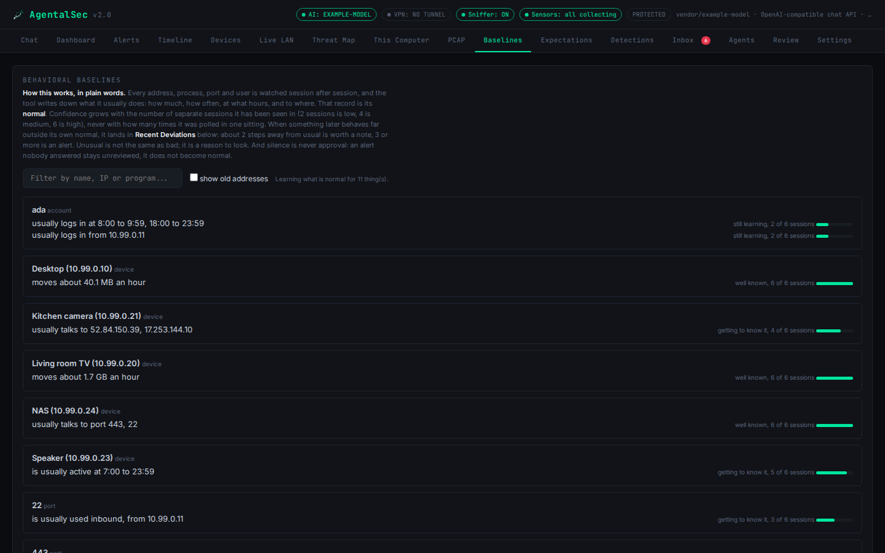

*What is normal for each account, device, port and program, in plain words.
Sample data.*

The baselines the tool has learned: for every address, process, port and
user, what it usually does, in one plain sentence, and how sure the tool is.
The bar on the right fills with the sessions it has seen: still learning,
getting to know it, then well known (low after 2 sessions, medium after 4,
high after 6). Below them, recent deviations: about two steps from usual is a
note, three or more is an alert. Unusual is not the same as bad, and silence
is never approval: an alert nobody answered goes to the Inbox, it does not
become normal.

  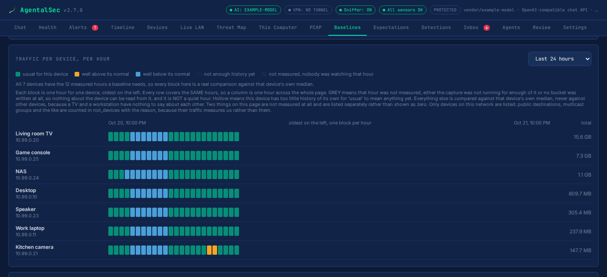

*Seven devices over 24 hours. The camera's two amber hours stand out against
its own normal. Sample data.*

**Traffic per device per hour.** For the last day, two days or week, one block
per hour, coloured against that device's own normal: usual, well above, well
below, not enough history (hollow), or not measured because nothing was
watching that hour (grey). A TV and a laptop are never compared with each
other. Performance signals this tool does not collect are listed by name
rather than shown as zero.

## Expectations

  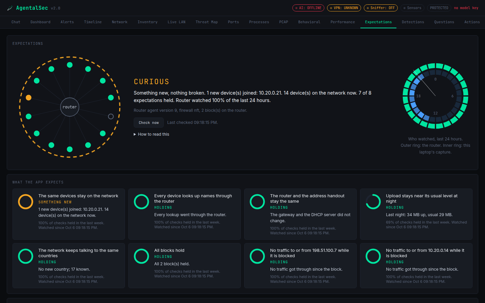

*The network mood with every device around the router, the 24 hour watch
clock, and a card for each expectation. The camera's block leaked, so the mood
is not calm. Sample data.*

What the app expects of your network, and whether it held. The app sets these
itself and checks them every five minutes against the router's records. No AI
tokens are spent on it.

The expectations:

- **The same devices stay on the network.** A new device is news, not an
  alarm.
- **Every device looks up names through the router.** A device that asks its
  own DNS server or a DNS over HTTPS resolver goes around the router's filter.
  Devices that already did this when the check started are left alone, a new
  one breaks it.
- **The router and the address handout stay the same.** A new gateway
  hardware address or a second DHCP server breaks it.
- **Upload stays near its usual level at night.** Between 1 and 6 in the
  morning, against the usual of the last two weeks. It needs three watched
  nights before it says anything.
- **The network keeps talking to the same countries.**
- **Smart devices and printers keep to their usual contacts.** A device you
  marked as a smart device or printer on the Devices tab that reaches a
  service it never used is news. It needs three days of watching first. TVs
  are left out, because they reach new streaming services every day; add
  `"tv"` to `simple_types` in the `expectations` block of config.json to hold
  them too.
- **Each block holds.** One per block on the router. If any connection to or
  from the blocked address gets an answer after the block, the block leaked.
  A block that disappears from the router without the app lifting it breaks
  too, until you mark it seen.

The mood at the top follows from them:

- **Calm:** everything held and the router was watched.
- **Curious:** something new, nothing broken.
- **Uncertain:** the app could not see enough to say, for example the router did
  not answer or its agent is too old to confirm a block.
- **Alarmed:** an expectation broke. It stays that way until you press
  "I have seen this" on the card.

Red is only used for a real break, never for a guess. If the router cannot
back a check, the card says "could not check" instead of "holding".

The ring around each card fills with the share of checks that held in the
last week. The clock on the right shows who was watching each hour: the outer
ring is the router, the inner ring is this laptop's own capture.

  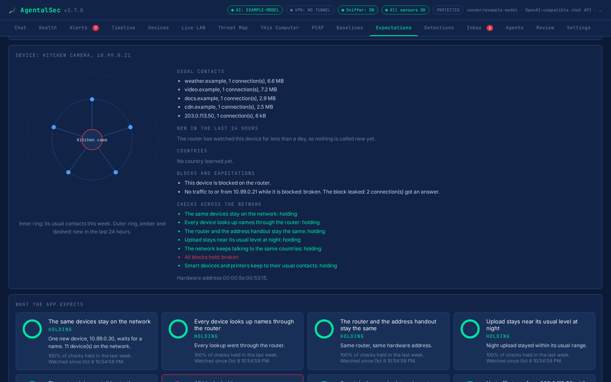

*One device: its usual contacts this week around it, with the amount sent to
each. Sample data.*

Click a device on the ring to see who it usually talks to this week, what is
new in the last 24 hours, its countries, and its blocks. For the first day a
device is watched, nothing is called new.

  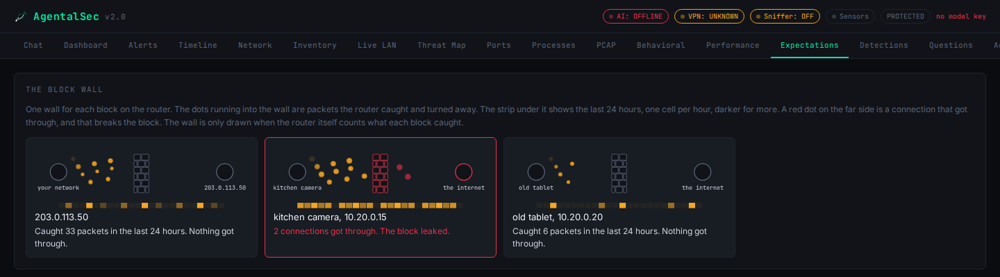

*Two blocks: one holding, one leaking. Sample data.*

**The block wall.** One wall for each block on the router. The amber dots
running into the wall are packets the router caught and turned away, and the
strip under it shows the last 24 hours, one cell per hour. A red dot on the far
side is a connection that got through. The router counts what each block
caught only with agent version 10 or newer; with an older agent, or when the
router cannot be read, no wall is drawn and the page says why. Run
`./scripts/install_gateway_agent.sh --enroll ROUTER_ADDRESS` again to update
the agent.

  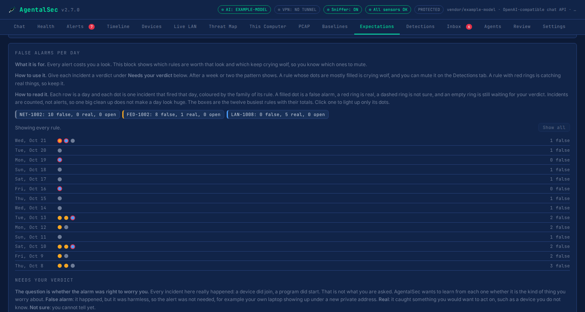

*False alarms per day for two weeks. Sample data.*

**False alarms per day.** Every alert costs you a look, and this shows which
rules are worth it and which keep crying wolf. One dot per incident that fired
that day, coloured by the rule's family. A filled dot is a false alarm, a red
ring is real, a dashed ring is not sure, an empty ring has no verdict yet. It
counts incidents, not alerts, so one big clean up does not make a day look
huge. Click a rule to light up only its dots, and **Show all** to go back. A
rule whose dots are mostly filled is the one to mute on the Detections tab.

Under it, **Needs your verdict** lists incidents that have none yet, with
three buttons: False alarm, Real, Not sure. You can also tell the analyst in
chat ("that was my backup job, it is a false alarm") and it records your
verdict, marked as given on your word. Incidents you dismissed before this
existed count as false alarms, marked "from a dismissal".

  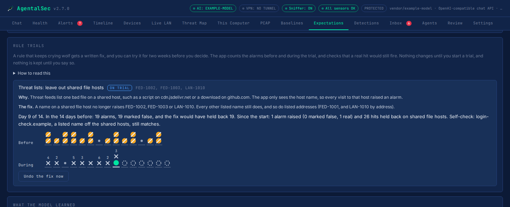

*A fix for the threat list rules, nine days into its trial. Sample data.*

**Rule trials.** A rule that keeps crying wolf gets a written fix, and you can
try it for two weeks before you decide. The first one is for the threat list
rules FED-1002, FED-1003 and LAN-1010: feeds list one bad file on a shared host, such as
a script on cdn.jsdelivr.net or a download on github.com, and the app only sees
the host name, so every visit to that host raised an alarm. The fix leaves
shared file hosts out. Every other listed name still fires.

Each column is a day. Before the trial you see the alarms of the last two
weeks, with a line through the ones the fix would have held back. During the
trial you see what still fired, the hits the fix held back as grey crosses, and
the days to come as dashed rings. A self-check runs on the threat lists: a
listed name off the shared hosts must still match, so you know real hits still
fire. A fix is suggested once you have marked one of its alarms a false alarm.
Nothing changes until you press **Start a two week trial**, and at the end you
choose **Keep the fix** or **Undo it**. Pick a rule in the false alarms block
and **Open its fix** takes you to its trial.

**The model proposes, Python verifies.** When the analyst calls an alarm
normal it has to name the fact that makes it so: a package install put the file
there, the destination is a big cloud or CDN, the device looked the name up
first, a time server, a call or game peer, the app's own traffic, or a reserved
name. Python checks that fact against its own records (the package database,
the network owner, the router's DNS and connection logs) and, if it does not
hold, the alarm reaches you with what Python found. Names, titles and other
text a device wrote are never evidence. Threat list hits, high and critical
alarms, and any alarm whose text reads like instructions to the analyst always
come to you.

**What the model learned.** When the analyst finds that an alarm is false and
will come back, it writes a quiet rule for that pattern, on fields nothing on
the network can write: a domain, a network owner, an address, a port, a
package, a device's hardware address together with another field. Every alarm a
rule holds back is checked again against the rule's fact. A rule made with
nobody watching is on trial for two weeks and lapses unless you press **Keep
this rule**; a rule can also rest on your own words in chat, and then it says
so. A rule can never hide a critical alarm or switch a whole rule off, and
**Undo this rule** brings its alarms back. The analyst makes at most five rules
a day on its own and closes at most forty incidents a day.

**Sorted by the model before you saw them.** Low and medium alarms wait here
first. The app gathers the evidence, the names the device looked up, who owns
the network, whether it is a big cloud or CDN, how many of your devices already
go there, the threat lists and the package records, and the analyst sorts them
in one short call every two minutes. What the evidence explains becomes part of
the baseline and never reaches your Inbox; the rest reaches you with the
analyst's reason. Threat list hits, high and critical alarms always come
straight to you, and anything the analyst could not look at within half an hour
is shown as raised. If one it called normal was not, **This was not normal,
show it** files it and undoes its rule. The tokens it spends count toward the
same daily limit as the analyst's other work.

The analyst's old prediction record is still at the bottom, folded away. The
analyst no longer makes predictions on its own; it makes one only when you ask.

## Detections

  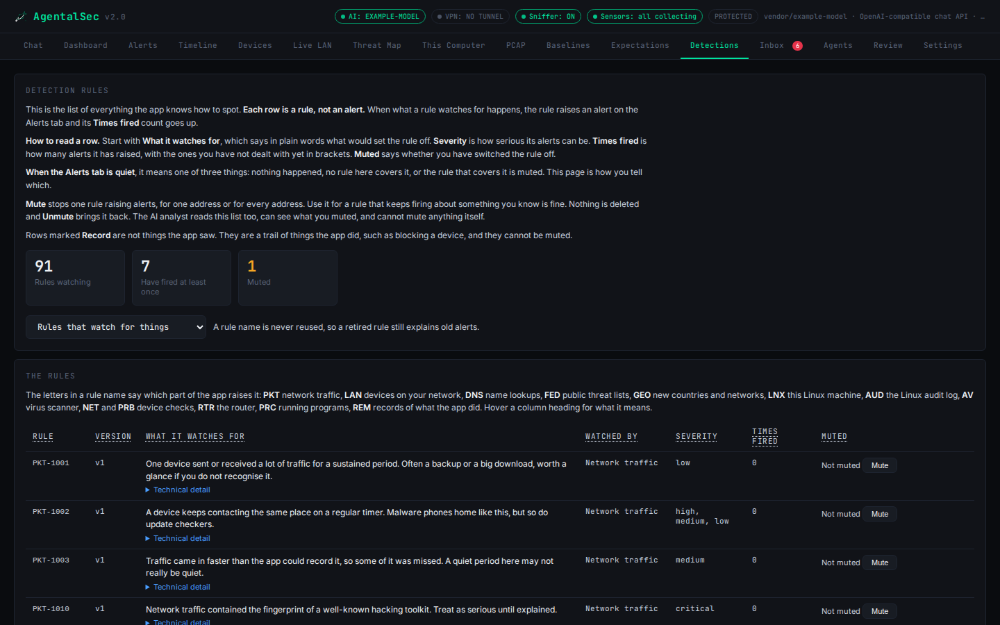

*The guide at the top, then each rule in plain words, with a Mute button on
every rule. Sample data.*

Everything the app knows how to spot. Each row is a rule, not an alert: when
what the rule watches for happens, it raises an alert on the Alerts tab and its
count here goes up.

How to read a row:

- **Rule** is its permanent name. The letters say which part of the app raises
  it (PKT network traffic, LAN devices on your network, DNS name lookups, FED
  public threat lists, GEO new countries and networks, LNX this machine, AUD
  the audit log, AV the virus scanner, NET and PRB device checks, RTR the
  router, PRC running programs, REM records of what the app did). Names are
  never reused, so an old alert always points at the rule that raised it.
- **Version** goes up when the rule's logic changes. Each alert remembers the
  version that raised it.
- **What it watches for** says it in plain words. **Technical detail** opens
  the exact condition.
- **Watched by**, **Severity** and **Times fired** say which part of the app
  runs it, how serious its alerts can be, and how many it has raised (open
  ones in brackets).
- **Muted** says whether you switched it off. **Mute** stops one rule for one
  address or for every address, with a reason you write; **Unmute** brings it
  back. Nothing is deleted.

When the Alerts tab is quiet, it means one of three things: nothing happened,
no rule here covers it, or the rule that covers it is muted. This tab tells
them apart. The analyst reads the same list and can see what you muted, but
only you can mute. Rows marked Record are a trail of what the app did, such as
blocking a device, and cannot be muted. Hover any column heading for its
meaning.

  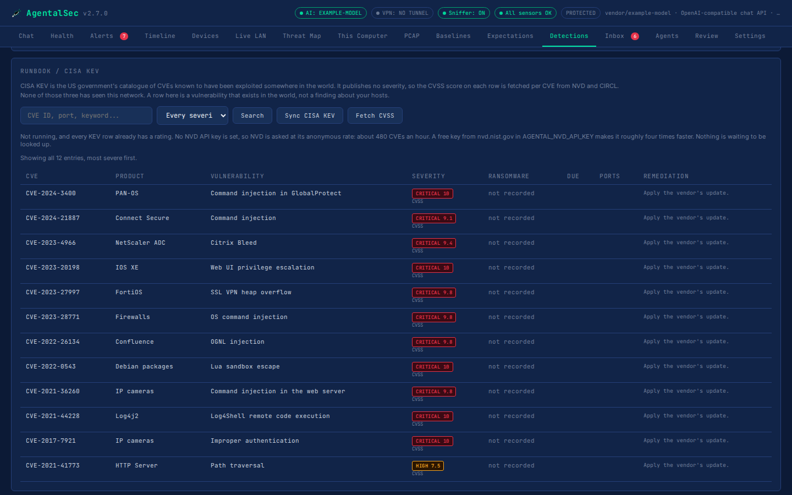

*The runbook at the bottom of the tab, most severe first. Sample data.*

**Runbook.** The CISA catalogue of known exploited vulnerabilities, with a
CVSS severity for each, searchable by CVE, port or keyword and filterable by
severity. Sync CISA KEV fetches the latest list, Fetch CVSS fills in scores
from NVD and CIRCL; the line under the buttons says how far that got. A row
here is a vulnerability that exists in the world, not a finding about your
machines.

## Inbox

  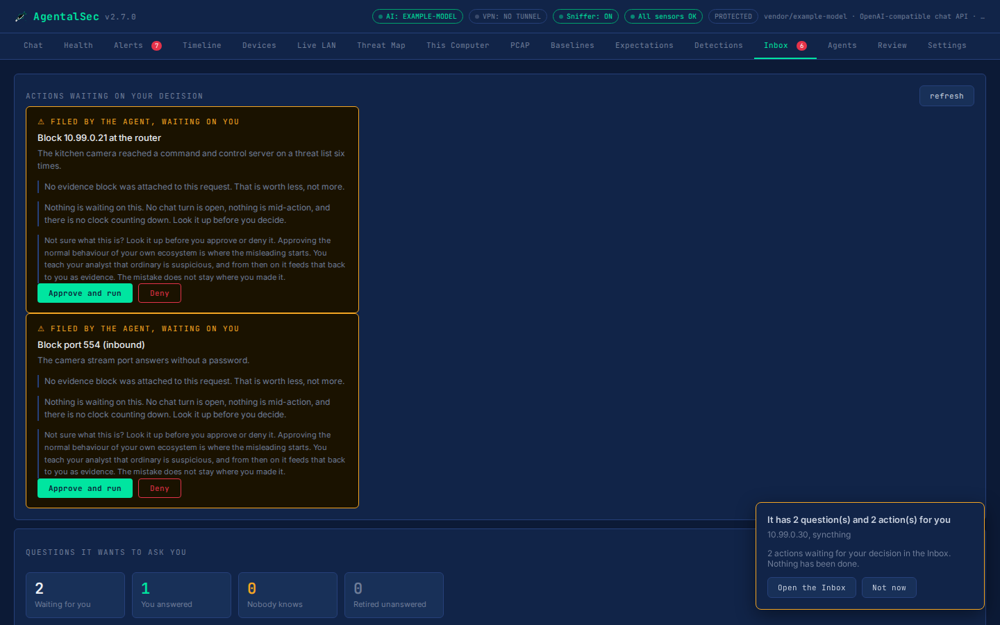

*Two actions waiting for a decision, and the popup that brings you here.
Sample data.*

Everything waiting on your answer, in one place. The badge counts what is
waiting and clears when you answer. When something new arrives while you are
on another tab, a small popup says how many questions and actions there are,
with **Open the Inbox** and **Not now**. It does not repeat itself, and it
keeps to a daily budget.

- **Actions waiting on your decision.** What the analyst wants to do, each as
  a card: what it would do, why, and the evidence. **Approve and run** or
  **Deny**. Nothing has run until you approve, and an approved action is
  carried out once by the executor, outside any chat.

  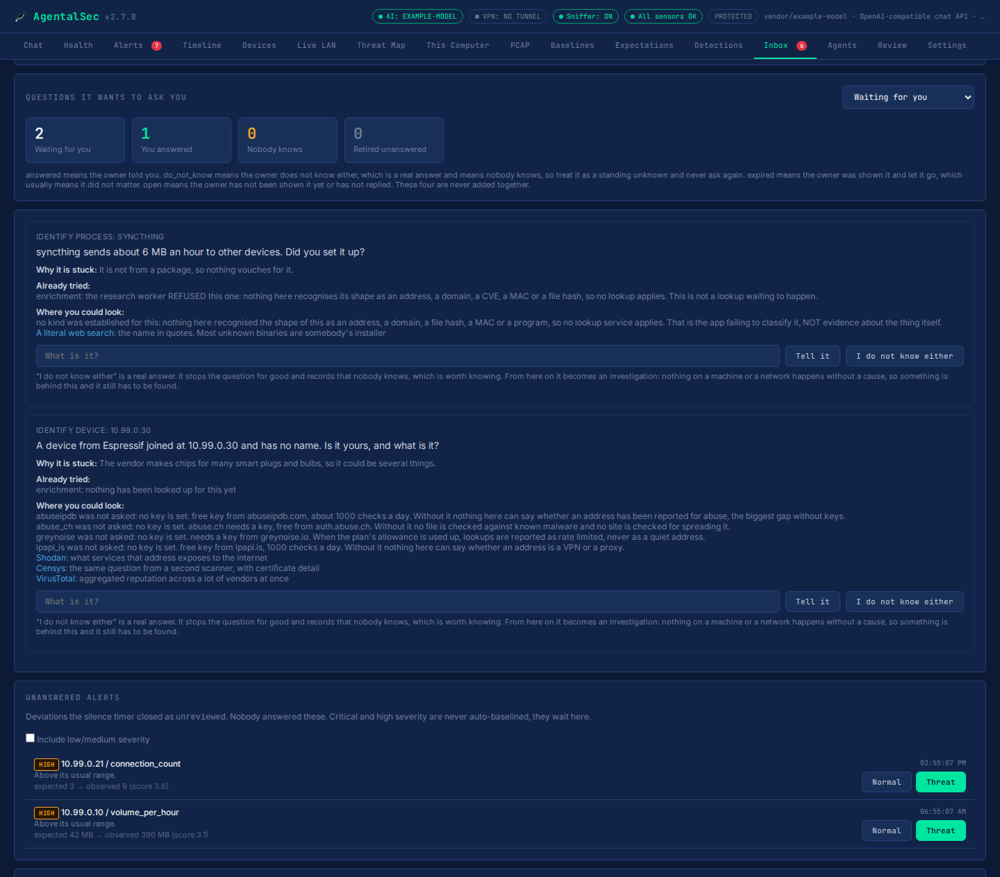

*Two questions, each with what was already tried and where you could look,
and two serious alerts nobody answered. Sample data.*

- **Questions it wants to ask you.** What the analyst cannot find out on its
  own, such as whether a device is yours. Each says why it is stuck, what was
  already tried, and where you could look. Type the answer and press **Tell
  it**, and the answer is used from then on. **I do not know either** is a
  real answer too: the question stops, and nobody knowing is recorded.
  Questions nobody answers retire after a while and are listed as such, never
  quietly treated as yes. The menu shows waiting, answered, nobody knows or
  retired.
- **Unanswered alerts.** Serious alerts nobody looked at before the silence
  timer closed them. Mark each one **Normal** or **Threat**. Tick the box to
  include low and medium ones.

  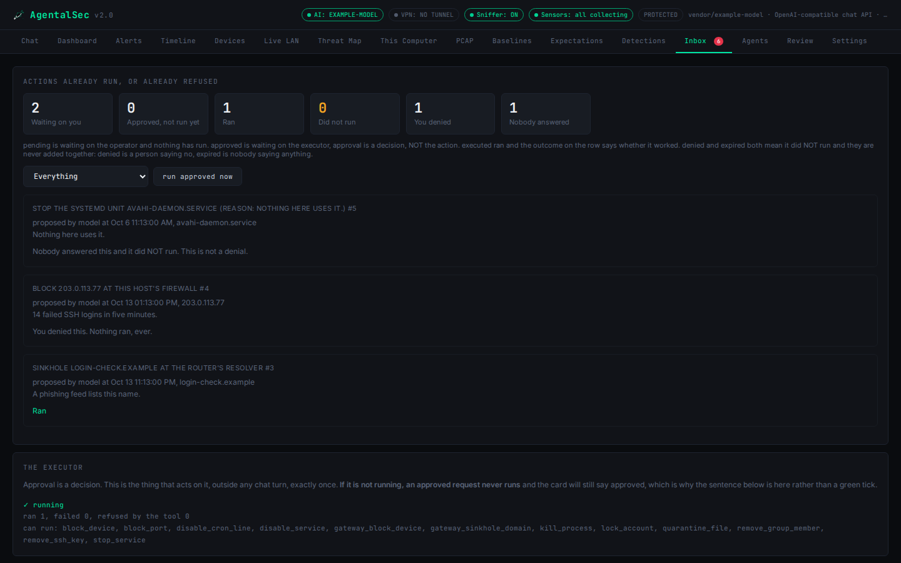

*The record of decided actions, and the executor that carries them out.
Sample data.*

- **Actions already run, or already refused.** The record of everything
  decided: ran, did not run, you denied, nobody answered. Denied and nobody
  answered are kept apart: one is a person saying no, the other is nobody
  saying anything.
- **The executor.** Whether the worker that carries out approved actions is
  running, and what it may run. If it is not running, an approved card would
  never run, which is why this says so in words.

## Agents

  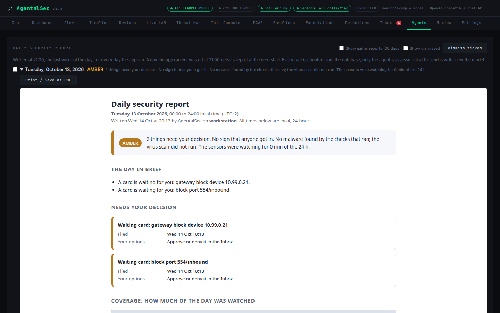

*The daily security report for one day, opened in the tab. Sample data.*

**Daily security report.** Written at 21:00, the last wake of the day, for
every day the app ran. Green, amber or red at the top, then the day in brief,
what needs your decision, and how much of the day was watched. Every fact in
it is counted from the database; only the agent's assessment at the end is
written by the model. **Print / Save as PDF** prints it on its own. Reports
are kept 30 days.

  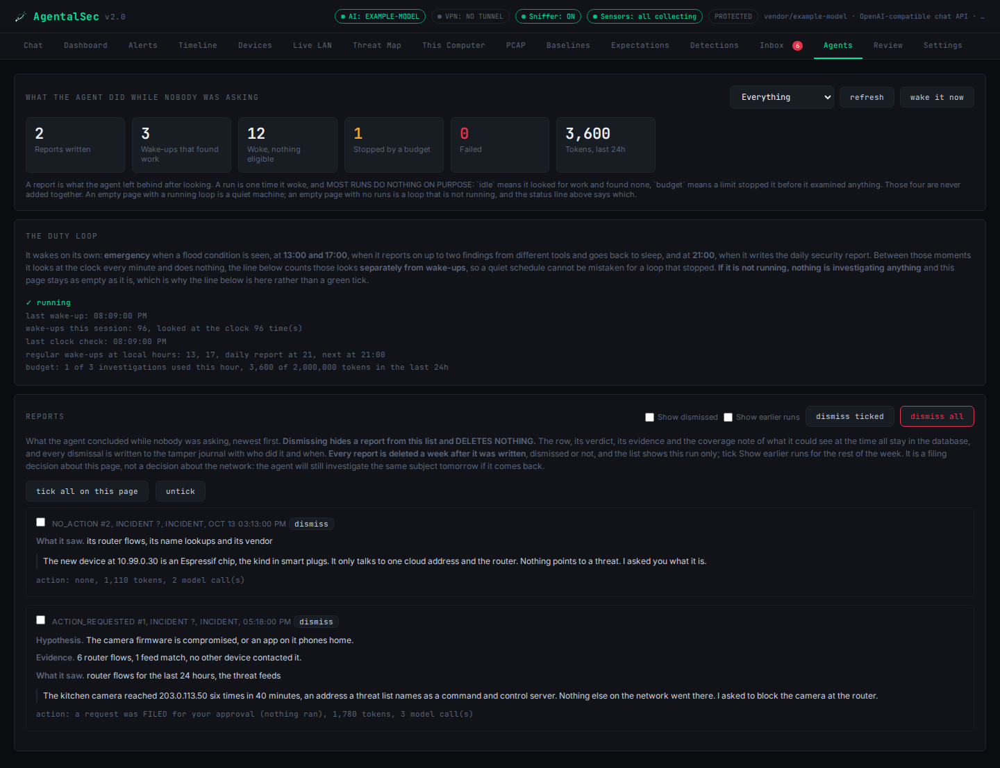

*The duty loop running, and its two reports: one about the new device, one
about the camera. Sample data.*

What the duty loop did while nobody was asking. The tiles count reports,
wake-ups that found work, wake-ups that found nothing, and wake-ups a budget
stopped. **The duty loop** says whether it is running, when it last woke, its
schedule and how much of its token budget it used. Its reports come newest
first, each with a verdict, the hypothesis, the evidence, what it saw, and
what it did. "Wake it now" starts a round by hand. Dismissing a report only
hides it here, it deletes nothing.

  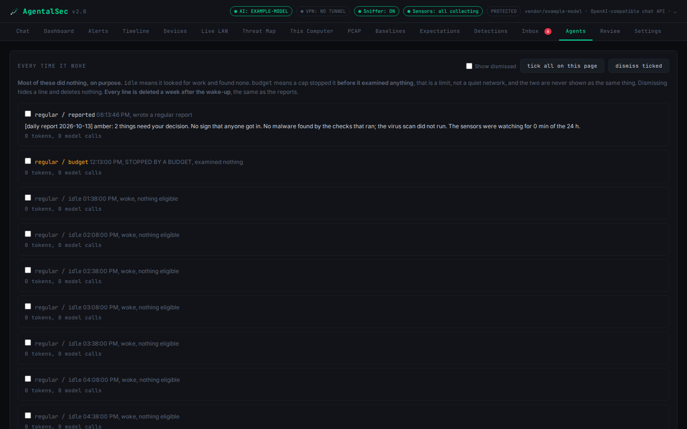

*Most wake-ups find nothing to do, on purpose. Sample data.*

**Every time it woke**, including the ones that found nothing to do, and the
reason: idle, or stopped by a budget. Idle means it looked and found nothing;
budget means a limit stopped it before it looked, and the two are never shown
as the same thing.

## Review

  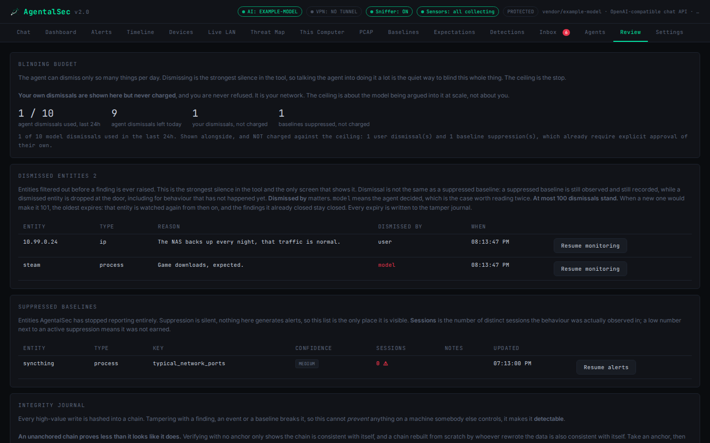

*One agent dismissal used of ten today, two dismissed entities and one
suppressed baseline. Sample data.*

Everything silenced, in one place.

- **Blinding budget.** How many things the analyst has dismissed today
  against its daily limit. Your own dismissals are shown, never limited.
- **Dismissed entities.** Addresses, processes and devices that are dropped
  before a finding is ever raised, with who dismissed them and why. A
  dismissal by the model is shown in red, because it is the case worth
  reading twice. At most 100 stand; the oldest expires when a new one is
  added. Resume monitoring undoes one.
- **Suppressed baselines.** Behaviour that is still recorded but no longer
  alerts. Resume alerts undoes one.
- **Integrity journal.** Every important write is chained by hash, so a
  change made behind the app's back shows. Take an anchor to have something
  to check the chain against later.
- **Ports you have said are normal.** Ports you declared normal for a named
  device, so the same open port stops raising a finding.

If the chat and this tab disagree about what is silenced, this tab is right.

## Settings

  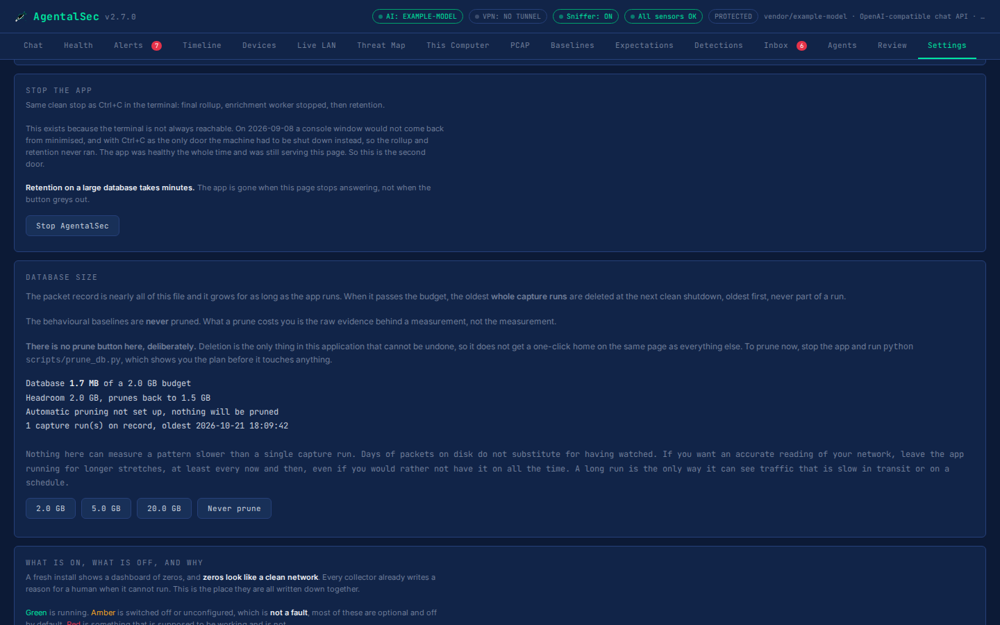

*Stop the app, and the database size against its budget. Sample data.*

- **Stop AgentalSec.** The same clean stop as Ctrl+C in the terminal, for
  when the terminal is out of reach. The app is gone when the page stops
  answering, not when the button greys out.
- **Database size.** How big the database is against its budget. Pick a
  budget with the buttons. The oldest whole capture runs go first, at a clean
  shutdown. There is no prune button on purpose; to prune now, stop the app
  and run `python scripts/prune_db.py`, which shows the plan first.

  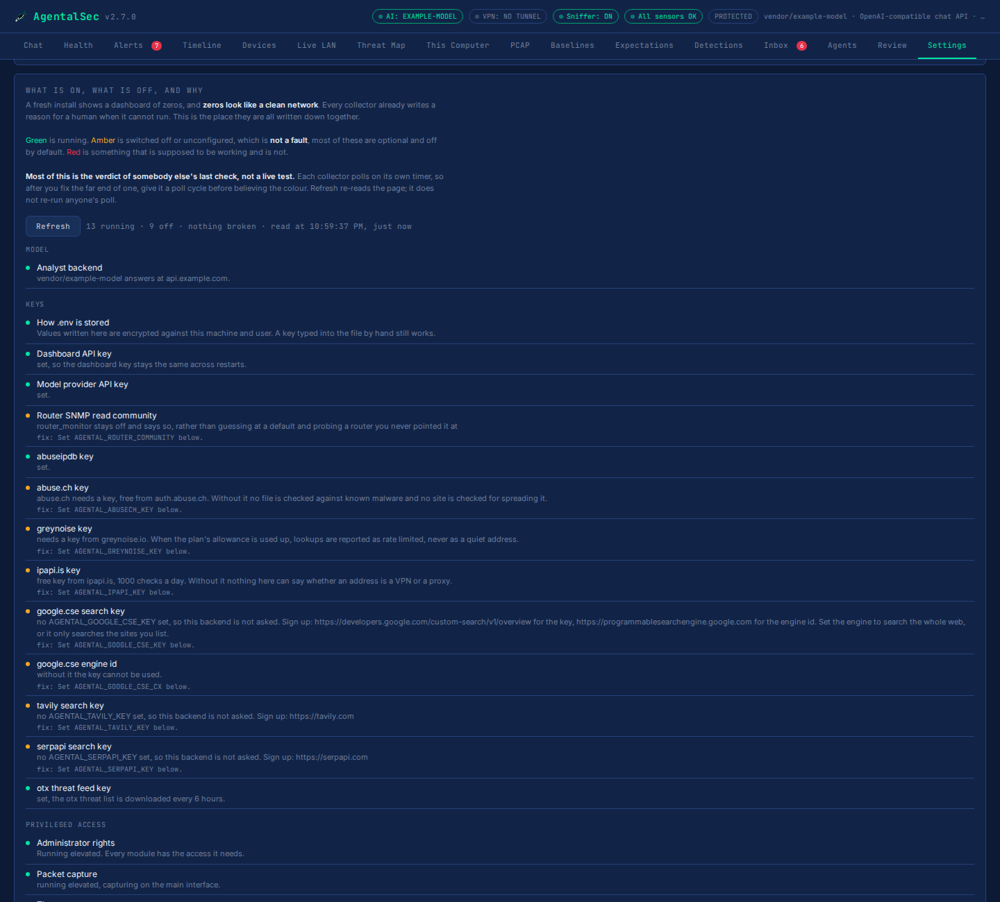

*Every collector and key with its state, and the fix for each one that is off.
Sample data.*

- **What is on, what is off, and why.** Every collector and key: green
  running, amber switched off or not configured, red supposed to work and not
  working, each with its reason and the fix.
- **Model provider.** Endpoint, model and key, with a check that the
  provider answers and knows the model.
- **Keys.** Each optional key in one field. A key typed here is stored
  encrypted in `.env`, and the line next to it says what it unlocks.
